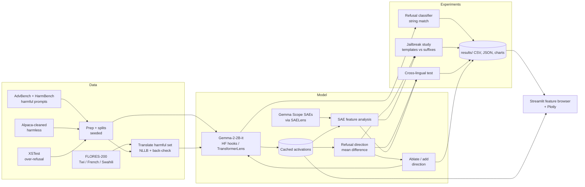

# PLAN.md: SafetyCircuits

An open study of how a small instruction-tuned LLM decides to refuse, using a refusal direction, sparse autoencoders and activation steering, and whether that mechanism carries over to Twi, French and Swahili.
Budget: 8 weeks of evenings and weekends, free compute (Kaggle/Colab GPU), free hosting, laptop and phone only.
Responsible handling: the study measures refusal behaviour only. It publishes refusal rates, activations and feature statistics, **never harmful completions**.

## Scope

| Area | Decision |
|---|---|
| Model | **google/gemma-2-2b-it** (2.61B parameters, about 5.2 GB in bf16, about 10.5 GB in fp32). Gated on Hugging Face; checked 2026-11-18. |
| SAEs | **Gemma Scope** `google/gemma-scope-2b-pt-res` (residual stream, CC-BY-4.0, not gated). **They are trained on the base model, not on 2B-it.** Instruction-tuned Gemma Scope SAEs exist only for 9B. We run them on 2B-it activations, and week 3 tests whether that works. One width (16k), canonical L0, a few layers. |
| Libraries | PyTorch, Hugging Face Transformers, SAELens. TransformerLens only if it supports Gemma-2 cleanly, otherwise plain Hugging Face hooks. No nnsight. |
| Harmful prompts | AdvBench (original GitHub CSV; the Hugging Face copy is gated) and HarmBench behaviours. About 100 held out for the translation set. |
| Harmless prompts | Alpaca-cleaned (prompts only, not redistributed). |
| Over-refusal | XSTest (250 safe, 200 unsafe prompts). |
| Languages | Twi (`twi_Latn`), French (`fra_Latn`), Swahili (`swh_Latn`). FLORES-200 has all three (Twi checked: 997 dev, 1,012 devtest lines). FLORES holds benign sentences only, so the harmful set (about 100 prompts) is machine-translated and back-translated, and FLORES is used for translation-quality checks and harmless controls. FLORES+ is restricted, so the original FLORES-200 download is used. |
| Refusal scoring | String-match classifier, validated by hand on 50 outputs. **No LLM judge.** |
| Jailbreaks | 5 prompt-template and 3 suffix jailbreaks. No optimised GCG attacks. |
| UI | Streamlit feature browser plus Plotly charts, running from a precomputed cache of 200–500 prompts. A live model call is an optional extra. |
| Secrets | `HF_TOKEN` only, in `.env` (gitignored) or Kaggle Secrets. `.env.example` holds the name with an empty value. |
| Out of scope | Training SAEs, fine-tuning, MLP/attention SAEs, GCG optimisation, nnsight, any model except Gemma-2-2B-it, publishing harmful completions. |

## 1. Architecture



- **Data prep**: downloads, cleans and splits the datasets with fixed seeds and records each source's licence.
- **Translation**: translates about 100 harmful prompts into Twi, French and Swahili with a machine-translation model, back-translates to check, and uses FLORES for quality checks and harmless controls. Ideally someone who reads Twi checks a sample.
- **Model wrapper**: loads Gemma-2-2B-it, runs prompts and caches residual-stream activations.
- **Refusal direction**: the mean activation on harmful prompts minus the mean on harmless ones, at a chosen layer and token position. The best layer is chosen on a validation split.
- **Steering**: removes the direction from every layer (ablation) or adds it to harmless prompts, and reports refusal and compliance rates, with XSTest as the over-refusal check.
- **SAE analysis**: finds the features that fire more on refusals than on compliance, and compares them with the direction.
- **Jailbreak study**: scores each jailbreak by how much it suppresses the refusal direction and features, next to its effect on the refusal rate.
- **Cross-lingual test**: applies the English direction to Twi, French and Swahili prompts and measures how well it separates harmful from harmless, with a "model understands the prompt" control.
- **Refusal classifier**: string-match on refusal phrases, hand-checked on 50 outputs.
- **Streamlit browser**: type a prompt, see the top features and the refusal score. It runs from the precomputed cache by default.

**Metrics**
- **Refusal rate** on harmful prompts and **over-refusal rate** on XSTest safe prompts.
- **Ablation effect**: the drop in refusal rate when the direction is removed, and the rise when it is added to harmless prompts.
- **Direction separation (AUROC)**: how well the projection onto the direction separates harmful from harmless prompts, per language.
- **Feature suppression**: the change in refusal-feature activation under each jailbreak.
- **SAE fit on 2B-it**: reconstruction error of the base-model SAEs on 2B-it activations, compared with the same SAEs on the base model.
- **Variance**: several seeds and prompt splits, with 95% confidence intervals (Wilson) for rates.

## 2. Compute budget

| Part | Where | Size |
|---|---|---|
| Model load | Kaggle P100 (16 GB) or Colab T4 (about 15 GB) | 5.2 GB in bf16. The T4 has no native bf16, so use fp32 (10.5 GB). Both fit. |
| One Gemma Scope SAE (16k) | same GPU | a few hundred MB |
| Activation caching and generation | GPU | a few hundred prompts per experiment, short generations |
| Analysis, plots, Streamlit | laptop | from cached activations only |
| Laptop CPU | optional | fp32 needs over about 12 GB of free RAM. Not assumed. |

Kaggle gives about 30 GPU hours a week, but the figure floats, so check your own quota in week 1. Every GPU step saves its outputs to files so a lost session costs nothing.

## 3. Repo structure

```
safetycircuits/
├── safetycircuits/
│   ├── data/          # fetch.py, prepare.py, translate.py, splits.py
│   ├── model/         # load.py, hooks.py, cache_acts.py
│   ├── refusal/       # direction.py, steer.py, classify.py
│   ├── sae/           # load_sae.py, features.py, scoring.py
│   ├── jailbreaks/    # templates.py, suffixes.py, study.py
│   ├── crosslingual/  # eval.py
│   └── config.py      # model id, layers, SAE ids, seeds
├── notebooks/         # Kaggle/Colab runners (GPU steps)
├── app/               # Streamlit feature browser + precomputed features
├── data/              # manifest, licence notes (raw data gitignored)
├── results/           # CSVs, charts, limitations, run_meta.json
├── docs/              # research-style report
├── tests/
├── .env.example       # HF_TOKEN=  (empty value)
├── .pre-commit-config.yaml
└── README.md, PLAN.md, BUILD_STEPS.md, CLAUDE.md, LEARNING.md, PROGRESS.md
```

**Keeping keys out of git**
- `.env` is in `.gitignore` from the first commit, and the code reads `HF_TOKEN` from the environment only.
- `.env.example` lists the variable name with an empty value.
- `pre-commit` runs **gitleaks** on every commit. In week 1, commit a fake test key once to confirm the block works, then delete it.
- On Kaggle or Colab, the token goes in the platform's Secrets, never in a notebook.

## 4. Week-by-week

| Week | Goal | Done when |
|---|---|---|
| 1 | Access + skeleton | Gemma licence accepted and `HF_TOKEN` works. 2B-it loads on Kaggle, and one Gemma Scope SAE loads via SAELens. Kaggle quota checked. Repo, pre-commit and gitleaks are in place, with `.env.example` names only. |
| 2 | Data + baseline | Data pipeline with saved splits and a licence table in the README. Baseline refusal rate on harmful vs harmless prompts. Refusal classifier hand-checked on 50 outputs. Translation-model licence checked. |
| 3 | Refusal direction | Direction found, with the layer chosen on validation. Ablation and addition work, with numbers and XSTest over-refusal. **Decision: do the base-model SAEs transfer to 2B-it?** If not, the SAE-based jailbreak comparison is dropped and the report says why. |
| 4 | SAE features | Refusal-feature list, overlap with the direction, and a feature-activation cache for the browser. |
| 5 | Jailbreak study | 5 template and 3 suffix jailbreaks scored on refusal rate and feature suppression. |
| 6 | Cross-lingual | Translations checked, Twi/French/Swahili results with the comprehension control. A Twi reader checks a sample if one is found. |
| 7 | Browser + evaluation | Streamlit feature browser on the cache. Repeat runs for variance, results table, 2–3 charts and a limitations section. |
| 8 | Ship + buffer | Deploy, README, report and portfolio card. No new features. |

## 5. Risks and first checks

1. **Data access and gating.** Gemma is gated (`manual` in the Hugging Face API, but the gate says "Requests are processed immediately"). You need to log in to Hugging Face, open `google/gemma-2-2b-it`, click **Acknowledge license**, then create a read token (Settings → Access Tokens) and set `HF_TOKEN` (Kaggle: Add-ons → Secrets). The Gemma Terms incorporate the Gemma Prohibited Use Policy, which must be read in full before anything is published. AdvBench on Hugging Face is gated, so use the GitHub CSV. FLORES+ is restricted, so use the original FLORES-200 download. *Check first (week 1):* the gate, a model load on Kaggle, a Gemma Scope load.
2. **Licences.**

   | Source | Licence (checked 2026-11-18) |
   |---|---|
   | AdvBench | MIT |
   | HarmBench | MIT (GitHub API) |
   | XSTest | CC-BY-4.0 |
   | Alpaca-cleaned | card says CC-BY-4.0, but the text comes from OpenAI models and the licence is disputed: use prompts only, do not redistribute |
   | FLORES-200 | CC-BY-SA 4.0: derived data keeps the same licence |
   | Gemma Scope SAEs | CC-BY-4.0 |
   | Gemma-2-2B-it | Gemma Terms of Use + Prohibited Use Policy |

   *Check first (week 2):* the machine-translation model's licence (believed non-commercial, not verified), and the exact Prohibited Use Policy wording.
3. **Compute.** The model fits a 16 GB GPU, and a 16k SAE is small. Kaggle's weekly quota floats, and the T4 has no native bf16. *Check first:* your own Kaggle quota, and your laptop RAM (unknown) before assuming any CPU run.

**Other risks.** (a) The base-model SAEs may fit the chat model poorly: measured in week 3, with a fallback to the direction alone. (b) Gemma-2-2B probably understands little Twi, so a "refusal" in Twi may just be confusion: every cross-lingual result carries a comprehension control. (c) Harmful prompts: only public benchmark prompts, no completions published, a responsible-use note in the README.

## 6. Simplifications

- No nnsight. TransformerLens only if it works with Gemma-2, otherwise plain Hugging Face hooks.
- One SAE width, residual-stream SAEs only, a few layers, not a full sweep.
- 5 template and 3 suffix jailbreaks, no GCG.
- About 100 translated prompts per language, not a large multilingual dataset.
- Automatic scoring only: string-match refusal classifier, no LLM judge.
- The browser runs from a precomputed cache, so hosting needs no GPU.
- **Free hosting:** Hugging Face Spaces or Streamlit Community Cloud, chosen in step 7.

## Concepts (plain language + one reading each)

- **Residual stream**: the running vector each layer reads from and adds to, which holds what the model currently "knows" about each token. *Read:* Elhage et al. 2021, "A Mathematical Framework for Transformer Circuits" (intro).
- **Refusal direction**: one direction in activation space that, when removed, stops the model refusing, and when added, makes it refuse. *Read:* Arditi et al. 2024, "Refusal in Language Models Is Mediated by a Single Direction" (arXiv).
- **Activation steering**: changing a model's behaviour by adding or removing a vector in its activations, with no retraining. *Read:* Turner et al. 2023, "Activation Addition" (arXiv).
- **Sparse autoencoders (SAEs)**: a small network that splits activations into many sparse, often human-readable features. *Read:* Bricken et al. 2023, "Towards Monosemanticity" (Anthropic).
- **Gemma Scope**: a free suite of SAEs for Gemma 2, trained mostly on base models. *Read:* Lieberum et al. 2024, "Gemma Scope" (arXiv 2408.05147).
- **Jailbreaks**: prompts or suffixes that make a model comply with harmful requests. *Read:* Zou et al. 2023, "Universal and Transferable Adversarial Attacks on Aligned Language Models" (arXiv).
- **Over-refusal**: refusing harmless prompts that merely look harmful. *Read:* Röttger et al. 2023, "XSTest" (arXiv).
- **Low-resource languages and safety**: safety training transfers poorly to languages with little data. *Read:* Yong et al. 2023, "Low-Resource Languages Jailbreak GPT-4" (arXiv).
- **Variance and confidence intervals**: one run gives a noisy rate, so repeat runs and a Wilson interval show the plausible range. *Read:* the Wikipedia article "Binomial proportion confidence interval" (Wilson section).
