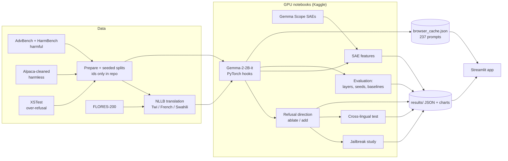

# SafetyCircuits: Interpreting Refusal and Jailbreaks in a Small LLM

**An open study of how Gemma-2-2B-it decides to refuse harmful requests, using a refusal direction, Gemma Scope sparse autoencoders and activation steering, and whether the mechanism carries over to Twi, French and Swahili.** It measures refusal behaviour only and publishes no harmful completions.

- **Demo:** _not deployed yet._ Deploy with [DEPLOY.md](DEPLOY.md), then put the link here.
- **Write-up:** [docs/technical_writeup.md](docs/technical_writeup.md) (about 3 pages). **Portfolio card:** [PORTFOLIO.md](PORTFOLIO.md).
- **Results table:** [results/results_table.md](results/results_table.md). **Weak points:** [results/limitations.md](results/limitations.md).

> **GIF placeholder:** record a 10 to 15 second screen capture of the feature browser (click an example, watch the gauge and feature chart) and save it as `docs/demo.gif`, then replace this line with ``.

## What it found

| Question | Result (Gemma-2-2B-it, test prompts) |
|---|---|
| Does one direction carry refusal? | Removing it cut refusals on harmful prompts from **97.9% to 7.6%** (144 prompts). A random direction left them at 97.6% ± 0.4%. Adding it made the model refuse 42.5% of harmless prompts (baseline 2.5%). |
| Is that just dataset style? | Word counts alone separate the two datasets (AUROC 0.99), so that test is easy. On XSTest, where safe and unsafe prompts share words, word counts score 0.61 and the direction 0.98. |
| Do base-model SAEs work on the chat model? | Yes, once the first token is excluded: reconstruction error 0.26 to 0.34 against 0.27 to 0.31 on the base model. |
| Which jailbreaks work? | Fiction frame got **43%** of harmful prompts past the refusal (baseline 2%), refusal suppression 26%. They also lower the refusal signal most. Research framing got 15% **without** lowering it. |
| Does it carry over to other languages? | French (AUROC 0.995) and Swahili (0.957): yes. Twi (0.56, chance): **inconclusive**, because Gemma barely understands Twi and the translations are poor. |

Mostly one seed and one model; the refusal judge is a phrase match that was not verified against harmful replies. Read [results/limitations.md](results/limitations.md) before using any number.

## Architecture



GPU steps run in notebooks (`notebooks/`) and save plain files; the laptop and the web app only read those files, so the demo needs no GPU.

## Run it

**On a laptop (tests and the app; no GPU)**

```powershell
py -3.11 -m venv .venv
.venv\Scripts\Activate.ps1
pip install -r requirements-dev.txt
pytest
streamlit run app/browser.py
```

On macOS or Linux use `python3.11 -m venv .venv` and `source .venv/bin/activate`. Docker: `docker compose up` serves the app on http://localhost:8501.

**Rebuild the data** (about 70 MB, needs internet): `python -m safetycircuits.data.fetch`, then `...data.prepare`, then `...data.report`. Raw files stay in gitignored folders.

**Re-run the experiments (Kaggle or Colab, free 16 GB GPU)**

1. On huggingface.co, open `google/gemma-2-2b-it` and click **Acknowledge license**. Create a read token.
2. In the notebook, add the token as the secret `HF_TOKEN` (Kaggle: Add-ons, Secrets). Never put it in the repo.
3. Run the notebooks in order: `01_refusal_direction`, `02_sae_features`, `03_jailbreaks`, `04_crosslingual`, `05_browser_cache`, `06_evaluation`. Each saves files to `results/`. Smoke-test with `--limit 16` first.
4. Rebuild the table and charts with `python -m safetycircuits.evaluation.report`.

## Repository map

| Path | Contents |
|---|---|
| `safetycircuits/data/` | download, clean, seeded splits, data report |
| `safetycircuits/refusal/`, `model/` | refusal direction, ablate/add hooks, refusal judge |
| `safetycircuits/sae/` | Gemma Scope loading, feature analysis, browser cache builder |
| `safetycircuits/jailbreaks/`, `crosslingual/` | jailbreak study, translation and cross-lingual test |
| `safetycircuits/evaluation/` | baselines, layer sweep, seeds, report builder |
| `app/browser.py` | Streamlit feature browser |
| `results/` | all numbers (JSON), table, charts, limitations |
| `PLAN.md`, `LEARNING.md`, `DEPLOY.md` | design, plain-English notes per step, deploy guide |

## Data and licences

The repo holds only ids (`data/splits.json`), checksums (`data/manifest.json`) and the data report. Prompt text stays in `data/raw/` and `data/interim/` (gitignored).

| Data | Licence (checked 2026-11-18) | Use here |
|---|---|---|
| AdvBench (llm-attacks) | MIT | 520 harmful behaviours, from the GitHub CSV (the Hugging Face copy is gated) |
| HarmBench | MIT | 200 standard text behaviours |
| XSTest | CC-BY-4.0 | 450 prompts (250 safe, 200 unsafe) for over-refusal |
| Alpaca-cleaned | CC-BY-4.0 on the dataset card; disputed because the text came from OpenAI models | 800 prompts sampled as harmless examples; prompts only, not redistributed |
| FLORES-200 | CC-BY-SA 4.0 | Twi, French, Swahili and English devtest sentences; anything derived from it keeps the same licence |
| NLLB-200 (translation model) | CC-BY-NC-4.0 | research use only; translated text is not committed |
| Gemma-2-2B-it | Gemma Terms of Use + Prohibited Use Policy (gated) | the model under study |
| Gemma Scope SAEs | CC-BY-4.0 | sparse autoencoders (trained on the base model) |

## Limitations

The refusal judge is a phrase match that could not be checked against harmful replies (project rule: never store or print them), and a second check confirms only about half of the "not refused" replies as real compliance. Layer 24 is not the best layer (early layers and layer 25 tie at 0% on validation prompts, confirmed on test only for 24 and 25). Twi translations are poor and unchecked by a Twi reader. Mostly one seed, one model, home-made jailbreaks. Full list: [results/limitations.md](results/limitations.md).

## Future work

Test all tied early layers; validate the judge on harmful replies in a private session; have a Twi reader review translations; ablate individual SAE features; more seeds, models and optimised jailbreaks.

## Responsible use

Public benchmark prompts only. The code stores refusal flags, scores and activations, never harmful model output. The demo runs no model and shows no model replies. Gemma is used under the Gemma Terms of Use; do not use this code to produce harmful content.

## References

Arditi et al. 2024 (arXiv:2406.11717), Lieberum et al. 2024 (2408.05147), Yong et al. 2023 (2310.02446), Wei et al. 2023 (2307.02483), Zou et al. 2023 (2307.15043), Mazeika et al. 2024 (2402.04249), Röttger et al. 2023 (2308.01263), NLLB Team 2022 (2207.04672).
