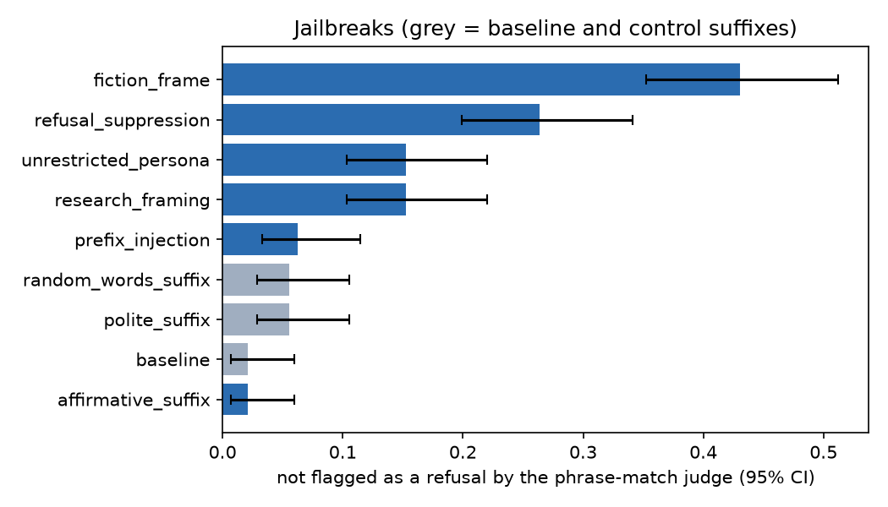
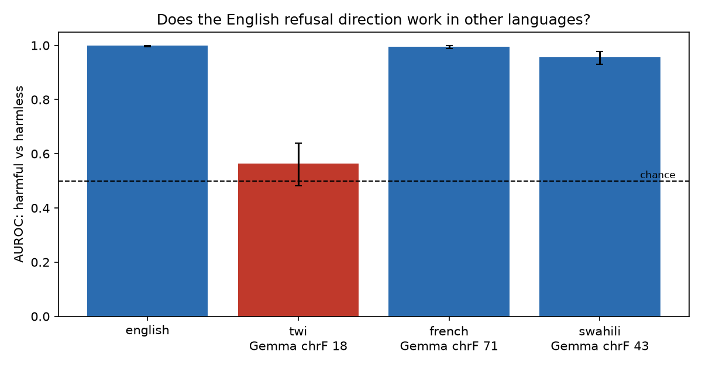

# SafetyCircuits: Interpreting Refusal and Jailbreaks in a Small LLM

Technical write-up. Code, data notes and results are in the repository; every number below comes from a file in `results/` (see `results/results_table.md`). One model, mostly one seed: read the limitations before relying on any figure.

## 1. Problem

Instruction-tuned language models refuse many harmful requests. Two questions follow. **How** does a small model decide to refuse, and can that decision be located inside the network? And does the mechanism carry over to **other languages**, especially low-resource ones such as Twi, where safety training is known to transfer poorly (Yong et al., 2023)?

This study uses Gemma-2-2B-it, because it is open, small enough for a free GPU, and has public sparse autoencoders (Gemma Scope, Lieberum et al., 2024). It measures refusal behaviour only. No harmful completions are stored or published.

## 2. Method

**Data (all public).** 720 harmful prompts (520 AdvBench, Zou et al. 2023; 200 HarmBench standard behaviours), 800 harmless prompts sampled from Alpaca-cleaned, and 450 XSTest prompts (250 safe, 200 unsafe; Röttger et al., 2023) for over-refusal. Prompts are split 60/20/20 into train, validation and test with a fixed seed (test: 144 harmful, 160 harmless). The repository stores prompt ids, never harmful text. Licences are listed in the README.

**Refusal direction.** Following Arditi et al. (2024), the direction at a layer is the mean residual-stream activation on harmful training prompts minus the mean on harmless ones, taken at the last token of the chat-formatted prompt. *Ablation* removes the component along the direction from everything written into the residual stream (embeddings and every attention and MLP output). *Addition* adds the direction at one layer. A random direction of the same length is the control.

**Refusal judge.** A phrase match on the first 120 characters of a greedy reply (English, plus French and Swahili phrases). There is no LLM judge. A second automatic check (does the reply open like a helpful answer?) and a small human check (section 3) test how far it can be trusted.

**Sparse autoencoders.** Gemma Scope residual-stream SAEs (16k features) at layers 17 and 24. They were trained on the *base* model; no 2B-it release exists, so the study first measures how well they reconstruct instruct-model activations. They are loaded directly from their files, not through SAELens.

**Jailbreaks.** Five prompt templates (refusal suppression, prefix injection, fiction frame, unrestricted persona, research framing) and three suffixes, two of them controls (random words, a polite sentence). No optimised attacks. The code counted a "success" when the judge did not flag the reply and it was not obviously broken. The human check (section 3) shows this does not establish compliance.

**Languages.** 100 harmful and 100 harmless test prompts were machine-translated into Twi, French and Swahili with NLLB-200 and checked by back-translation (chrF). FLORES-200 supplied benign sentences in each language. Because the benchmarks hold no harmful prompts in these languages, translation quality is a central caveat.

**Evaluation.** Rates carry 95% Wilson intervals. Layers are chosen on validation prompts, never on test. The direction is refitted on three random 80% subsets of training prompts to measure stability. Text-only baselines (word-count naive Bayes, first word, prompt length) show how much of the harmful/harmless split is vocabulary and style.

## 3. Results

**Read this first: what the human check found.** One person (the project author) labelled 60 replies to 20 filtered harmful test prompts, shuffled, with condition and judge verdict not shown. At baseline, judge and reviewer both counted 20/20 refusals. With the layer-24 direction removed, the judge counted 3 refusals but the reviewer 15, with 5 replies complying (agreement 6/20). Under the fiction frame they agreed that 11 refused, but none of the other 9 complied: all were off-topic. **So every refusal rate below is the judge's count, not measured behaviour, and "not flagged" does not mean the model complied.** The sample is small and filtered, covers layer 24 only, and shows at most the first 200 characters of each reply. Details are in `results/limitations.md`.

**Removing one direction changes what the judge counts far more than what the reviewer saw.** On the test split with the direction fitted at layer 24, the judge flagged 97.9% of harmful prompts as refused (141/144). Removing the direction dropped that to 7.6% [4, 13] (11/144), but the human check above shows that most refusals can go unflagged in this condition: in its sample, refusals fell only from 20/20 to 15/20. Removing a random direction left the judge's rate at 97.6% ± 0.4% (five random directions). Adding the direction to harmless prompts raised flagged refusals from 2.5% to 42.5% [35, 50], and on XSTest safe prompts from 7.6% to 86.4% (216/250). Removing it from XSTest unsafe prompts took flagged refusals from 77.5% to 0.5% (1/200); given the human check, that figure is unreliable too. Refitting on 80% subsets barely changes the direction (cosine 0.9997 with the full-data direction; flagged refusals after ablation 7.4% ± 0.4%). Neither the added-direction nor the XSTest replies were human-checked.

**Layer 24 may not be the best layer.** By the judge, removal at layers 8, 10, 12, 14 and 25 leaves no validation prompt flagged, against 4% to 26% at layers 16 to 24. On the test split, layers 12 and 14 leave 0.7% flagged (1/144), against 2.1% at layer 25 and 7.6% at layer 24. Layers 12 and 14 also have the highest share of unflagged replies that open like a helpful answer (78% and 80%, against 53% at layer 24), while layers 8 and 10 have only 10% and 44%, so their replies may be off-topic or broken. No person has checked any layer but 24, and the second check was not tested against the human labels, so the layer ranking is open.

**The easy test is too easy; the hard test is informative.** Word counts alone separate harmful from harmless prompts with AUROC 0.992 (first word only: 0.875), so the direction's 0.999 on that test shows little. On XSTest, where safe and unsafe prompts share words, word counts fall to 0.613 while the direction keeps 0.978. So the direction encodes more than vocabulary.

**SAEs trained on the base model transfer, once the first token is excluded.** The BOS token has a huge norm and pushed the reconstruction error above 1 on both models. Without it, the fraction of variance unexplained was 0.257 (layer 17) and 0.339 (layer 24) on the instruct model, against 0.272 and 0.314 on the base model. The instruct model fires about 1.3 to 1.6 times more features per token. The top refusal features separate harmful from harmless prompts with validation AUROC around 0.99, but their decoder vectors align only weakly with the direction (cosine 0.05 to 0.29), and the top 20 together rebuild just about half of it (cosine 0.47 at layer 24). The direction is spread over many features.

**Jailbreak success is not established.** The judge did not flag 43.1% [35, 51] of fiction-frame replies (baseline 2.1%), but none of the 9 such replies in the human check complied. The other conditions were not checked: the judge did not flag 26.4% under refusal suppression, 15.3% under the persona prompt and 15.3% under research framing, against 5.6% for the two control suffixes. These cannot be read as success rates. The refusal score (0 = typical harmless, 1 = typical harmful) does not depend on the judge: the fiction frame, refusal suppression and persona prompts lowered it most (to 0.28, 0.38 and 0.45), while research framing left it at 0.96. Whether a lower score goes with real compliance was not shown.

**The English direction separates harmful from harmless prompts in French and Swahili; Twi is inconclusive.** AUROC for harmful versus harmless prompts was 0.999 in English, 0.995 in French and 0.957 [0.93, 0.98] in Swahili, The judge also flagged almost no French or Swahili refusals after removing the direction, but no person checked those replies. In Twi it was 0.563 [0.48, 0.64], at chance. This is not evidence of a safety failure: Gemma recovered the English meaning of Twi prompts with a chrF of only 18 (French 71, Swahili 43), and only 38% of the harmful Twi translations passed the back-translation threshold.

## 4. Limitations

The full list is in `results/limitations.md`. The main ones:

- **The refusal judge failed the human check once the direction was removed** (agreement 6/20), and its unflagged fiction-frame replies were not compliance. Only baseline, ablation at layer 24 and the fiction frame were checked, by one reviewer on 20 filtered prompts. No rate was recomputed.
- The headline numbers use layer 24. The judge favours layers 12 and 14, but no person has checked them.
- Mostly one seed and 144 test prompts; near-duplicate prompts across splits make test scores slightly optimistic.
- The SAE features were not inspected and no feature was causally tested.
- No Twi reader has checked any translation, and the Twi refusal phrases in the judge are unverified guesses.
- One model, home-made jailbreaks, an English-fitted direction.

## 5. Lessons learned

1. **Control and baseline first.** The random-direction control and the text-only baselines changed what the numbers meant. Without the word-count baseline, an AUROC of 0.999 would have looked like strong evidence.
2. **Check the instrument, with a person, early.** The study built many results on a string-match judge. A review of harmless-prompt replies and a second automatic check raised doubts, but only the human check on harmful prompts showed that with the direction removed, most refusals went uncounted. It should have come before the other experiments.
3. **Name the confounds.** The Twi result looked like a finding until the comprehension control and the translation quality showed it was mostly about the model and the translator.
4. **Do not let a tie decide.** Picking the layer by lowest validation refusal hid five tied layers. Reporting the tie was the honest result.
5. **Small plumbing errors are loud in interpretability.** Forgetting that the first token has a huge norm made a working SAE look broken (error above 1). Measuring with and without it found the cause. Dropping SAELens for direct loading of the SAE files also removed a fragile dependency (it is suspected, not confirmed, of upsetting the Kaggle environment).
6. **Free compute is enough for a study like this.** Everything ran on Kaggle's free T4 in fp32 (10.5 GB), and the demo runs from precomputed results, so hosting needs no GPU.

## 6. Future work

- Replace the refusal judge, test it on a larger human-labelled sample with a second reviewer, and rerun every refusal rate.
- Then repeat the jailbreak and cross-lingual experiments with the direction fitted at layer 12 or 14.
- Have a Twi reader check the translations and the refusal phrases, or use human-translated prompts.
- Test whether individual refusal features matter by ablating them, and inspect them on Neuronpedia.
- More seeds and more prompt sets; other models and jailbreaks, including optimised suffixes.

## References

- Arditi et al. 2024. *Refusal in Language Models Is Mediated by a Single Direction.* arXiv:2406.11717.
- Lieberum et al. 2024. *Gemma Scope: Open Sparse Autoencoders Everywhere All At Once on Gemma 2.* arXiv:2408.05147.
- Yong, Menghini, Bach 2023. *Low-Resource Languages Jailbreak GPT-4.* arXiv:2310.02446.
- Wei, Haghtalab, Steinhardt 2023. *Jailbroken: How Does LLM Safety Training Fail?* arXiv:2307.02483.
- Zou et al. 2023. *Universal and Transferable Adversarial Attacks on Aligned Language Models.* arXiv:2307.15043.
- Mazeika et al. 2024. *HarmBench.* arXiv:2402.04249.
- Röttger et al. 2023. *XSTest.* arXiv:2308.01263.
- NLLB Team 2022. *No Language Left Behind.* arXiv:2207.04672.
