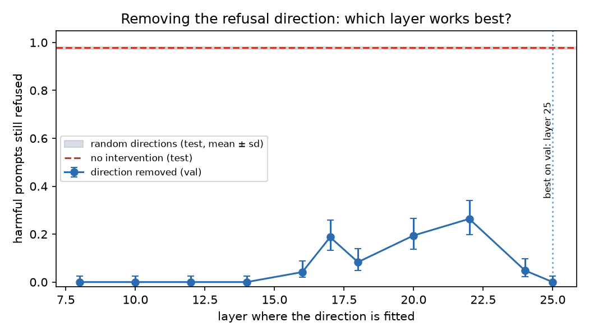

# SafetyCircuits: Interpreting Refusal and Jailbreaks in a Small LLM

Technical write-up. Code, data notes and results are in the repository; every number below comes from a file in `results/` (see `results/results_table.md`). One model, mostly one seed: read the limitations before relying on any figure.

## 1. Problem

Instruction-tuned language models refuse many harmful requests. Two questions follow. **How** does a small model decide to refuse, and can that decision be located inside the network? And does the mechanism carry over to **other languages**, especially low-resource ones such as Twi, where safety training is known to transfer poorly (Yong et al., 2023)?

This study uses Gemma-2-2B-it, because it is open, small enough for a free GPU, and has public sparse autoencoders (Gemma Scope, Lieberum et al., 2024). It measures refusal behaviour only. No harmful completions are stored or published.

## 2. Method

**Data (all public).** 720 harmful prompts (520 AdvBench, Zou et al. 2023; 200 HarmBench standard behaviours), 800 harmless prompts sampled from Alpaca-cleaned, and 450 XSTest prompts (250 safe, 200 unsafe; Röttger et al., 2023) for over-refusal. Prompts are split 60/20/20 into train, validation and test with a fixed seed (test: 144 harmful, 160 harmless). The repository stores prompt ids, never harmful text. Licences are listed in the README.

**Refusal direction.** Following Arditi et al. (2024), the direction at a layer is the mean residual-stream activation on harmful training prompts minus the mean on harmless ones, taken at the last token of the chat-formatted prompt. *Ablation* removes the component along the direction from everything written into the residual stream (embeddings and every attention and MLP output). *Addition* adds the direction at one layer. A random direction of the same length is the control.

**Refusal judge.** A phrase match on the first 120 characters of a greedy reply (English, plus French and Swahili phrases). There is no LLM judge. A second, independent check (does the reply open like a helpful answer?) is used to test how far the first one can be trusted.

**Sparse autoencoders.** Gemma Scope residual-stream SAEs (16k features) at layers 17 and 24. They were trained on the *base* model; no 2B-it release exists, so the study first measures how well they reconstruct instruct-model activations. They are loaded directly from their files, not through SAELens.

**Jailbreaks.** Five prompt templates (refusal suppression, prefix injection, fiction frame, unrestricted persona, research framing) and three suffixes, two of them controls (random words, a polite sentence). No optimised attacks. A jailbreak "succeeds" when the reply is not a refusal and not broken text.

**Languages.** 100 harmful and 100 harmless test prompts were machine-translated into Twi, French and Swahili with NLLB-200 and checked by back-translation (chrF). FLORES-200 supplied benign sentences in each language. Because the benchmarks hold no harmful prompts in these languages, translation quality is a central caveat.

**Evaluation.** Rates carry 95% Wilson intervals. Layers are chosen on validation prompts, never on test. The direction is refitted on three random 80% subsets of training prompts to measure stability. Text-only baselines (word-count naive Bayes, first word, prompt length) show how much of the harmful/harmless split is vocabulary and style.

## 3. Results

**A single direction carries refusal in this model.** On the test split with the direction fitted at layer 24, 97.9% of harmful prompts were refused (141/144). Removing the direction dropped that to 7.6% [4, 13] (11/144). Removing a random direction left it at 97.6% ± 0.4% (five random directions). Adding the direction to harmless prompts raised refusals from 2.5% to 42.5% [35, 50], and on XSTest safe prompts from 7.6% to 86.4% (216/250). Removing it from XSTest unsafe prompts took refusals from 77.5% to 0.5% (1/200). Refitting on 80% subsets barely changes the direction (cosine 0.9997 with the full-data direction; refusal after ablation 7.4% ± 0.4%).

**Layer 24 is not the best layer.** Validation prompts show removal works best at layers 8, 10, 12, 14 and 25 (0% still refused), worse at layers 16 to 24 (4% to 26%). Five layers tie and the code broke the tie arbitrarily, picking 25 (2.1% refused on test). Only layers 24 and 25 were run on the test split, so the early-layer result is a lead, not a finding.

**The easy test is too easy; the hard test is informative.** Word counts alone separate harmful from harmless prompts with AUROC 0.992 (first word only: 0.875), so the direction's 0.999 on that test shows little. On XSTest, where safe and unsafe prompts share words, word counts fall to 0.613 while the direction keeps 0.978. So the direction encodes more than vocabulary.

**SAEs trained on the base model transfer, once the first token is excluded.** The BOS token has a huge norm and pushed the reconstruction error above 1 on both models. Without it, the fraction of variance unexplained was 0.257 (layer 17) and 0.339 (layer 24) on the instruct model, against 0.272 and 0.314 on the base model. The instruct model fires about 1.3 to 1.6 times more features per token. The top refusal features separate harmful from harmless prompts with validation AUROC around 0.99, but their decoder vectors align only weakly with the direction (cosine 0.05 to 0.29), and the top 20 together rebuild just about half of it (cosine 0.47 at layer 24). The direction is spread over many features.

**Some jailbreaks work by lowering the refusal signal; one does not.** The fiction frame got 43.1% [35, 51] of harmful prompts past the refusal (baseline 2.1%), refusal suppression 26.4%, the persona prompt 15.3%. These also pulled the refusal score (0 = typical harmless, 1 = typical harmful) down the most (0.28, 0.38, 0.45). Research framing also reached 15.3% but left the score at 0.96, so the model stopped refusing without the direction moving: the single-direction story does not explain every jailbreak. The two control suffixes alone gave 5.6%, so gaps of a few points are noise.

**The English direction works in French and Swahili; Twi is inconclusive.** AUROC for harmful versus harmless prompts was 0.999 in English, 0.995 in French and 0.957 [0.93, 0.98] in Swahili, and removing the direction removed refusals in both. In Twi it was 0.563 [0.48, 0.64], at chance. This is not evidence of a safety failure: Gemma recovered the English meaning of Twi prompts with a chrF of only 18 (French 71, Swahili 43), and only 38% of the harmful Twi translations passed the back-translation threshold.

## 4. Limitations

The full list is in `results/limitations.md`. The main ones:

- **The refusal judge is unvalidated on harmful prompts.** After removing the direction, 133 replies were "not refused"; the second check confirms 71 as helpful-looking and cannot classify 62. For the fiction-frame jailbreak it confirms none of 62, because stories do not open with "Sure". So the jailbreak success rates are unconfirmed. Reading harmful replies by hand would settle it but conflicts with the project's rule of not storing or printing them.
- Early-layer ablation was confirmed only on validation prompts.
- Mostly one seed and 144 test prompts; near-duplicate prompts across splits make test scores slightly optimistic.
- The SAE features were not inspected and no feature was causally tested.
- No Twi reader has checked any translation, and the Twi refusal phrases in the judge are unverified guesses.
- One model, home-made jailbreaks, an English-fitted direction.

## 5. Lessons learned

1. **Control and baseline first.** The random-direction control and the text-only baselines changed what the numbers meant. Without the word-count baseline, an AUROC of 0.999 would have looked like strong evidence.
2. **Check the instrument.** A string-match refusal judge is easy to build and hard to trust. The second check showed that "not refused" often cannot be read as "complied".
3. **Name the confounds.** The Twi result looked like a finding until the comprehension control and the translation quality showed it was mostly about the model and the translator.
4. **Do not let a tie decide.** Picking the layer by lowest validation refusal hid five tied layers. Reporting the tie was the honest result.
5. **Small plumbing errors are loud in interpretability.** Forgetting that the first token has a huge norm made a working SAE look broken (error above 1). Measuring with and without it found the cause. Dropping SAELens for direct loading of the SAE files also removed a fragile dependency (it is suspected, not confirmed, of upsetting the Kaggle environment).
6. **Free compute is enough for a study like this.** Everything ran on Kaggle's free T4 in fp32 (10.5 GB), and the demo runs from precomputed results, so hosting needs no GPU.

## 6. Future work

- Run the test split for all tied early layers and check their replies stay coherent.
- Validate the judge on harmful replies with a human reviewer in a private session (nothing saved), or a separate classifier.
- Have a Twi reader check the translations and the refusal phrases, or use human-translated prompts.
- Test whether individual refusal features matter by ablating them, and inspect them on Neuronpedia.
- More seeds and more prompt sets; other models and jailbreaks, including optimised suffixes.

## References

- Arditi et al. 2024. *Refusal in Language Models Is Mediated by a Single Direction.* arXiv:2406.11717.
- Lieberum et al. 2024. *Gemma Scope: Open Sparse Autoencoders Everywhere All At Once on Gemma 2.* arXiv:2408.05147.
- Yong, Menghini, Bach 2023. *Low-Resource Languages Jailbreak GPT-4.* arXiv:2310.02446.
- Wei, Haghtalab, Steinhardt 2023. *Jailbroken: How Does LLM Safety Training Fail?* arXiv:2307.02483.
- Zou et al. 2023. *Universal and Transferable Adversarial Attacks on Aligned Language Models.* arXiv:2307.15043.
- Mazeika et al. 2024. *HarmBench.* arXiv:2402.04249.
- Röttger et al. 2023. *XSTest.* arXiv:2308.01263.
- NLLB Team 2022. *No Language Left Behind.* arXiv:2207.04672.
